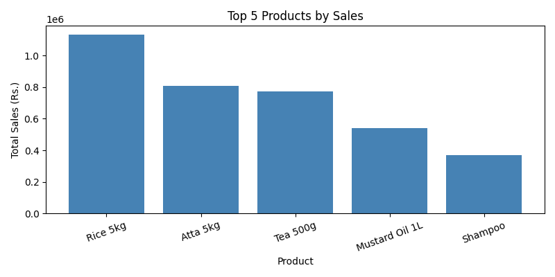
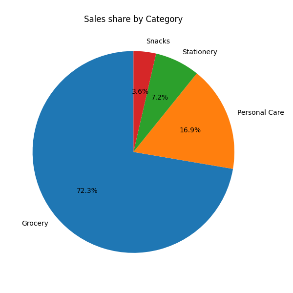
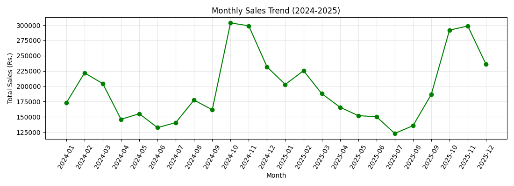
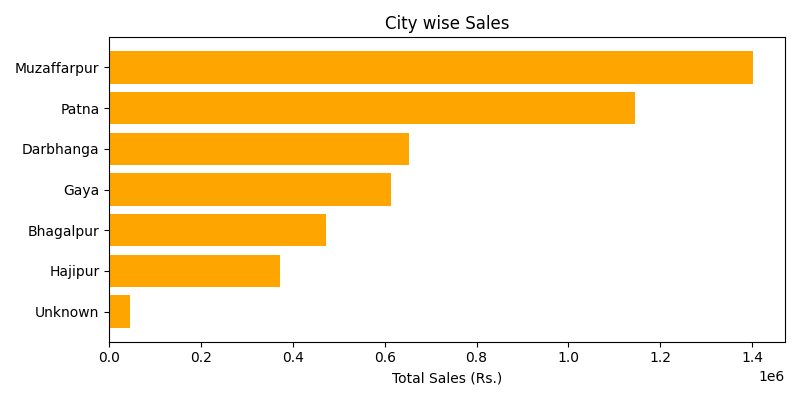

# Sales Data Analysis using Python

Analysis of 10,000 sales orders of a general store (Bihar) using **Python, pandas, NumPy and Matplotlib**.

> The dataset is a sample dataset created by me (`generate_data.py`) for practice. It is not real shop data.

## What I did
1. Loaded the data and checked it (`shape`, `info`, missing values, duplicates)
2. Cleaned the data
   - removed 250 duplicate rows
   - fixed city names (extra spaces, lower case)
   - filled missing values in `city` and `payment_mode`
   - converted `order_date` to date type
3. Created new columns: `total_sales`, `month`, `year`
4. Analysed sales using `groupby` (products, category, month, city, payment mode)
5. Made charts with Matplotlib and wrote my findings

## Key findings
- Total sales: about Rs. 47 lakh (2024-2025), average order value about Rs. 470
- Grocery is about 72% of total sales
- Rice 5kg is the top product, then Atta 5kg and Tea 500g
- Sales are highest in Oct-Nov (festival season) and lowest in Jun-Aug
- Muzaffarpur and Patna are the top 2 cities
- Cash 45%, UPI 43%, Card 10%

## Charts
| | |
|---|---|
|  |  |
|  |  |

## Project files
```
sales-analysis/
├── data/
│   ├── sales_data.csv            (raw data)
│   └── sales_data_cleaned.csv    (after cleaning)
├── charts/                       (saved charts)
├── generate_data.py              (creates the sample data)
├── sales_analysis.ipynb          (main analysis notebook)
├── requirements.txt
└── README.md
```

## How to run
```
pip install -r requirements.txt
python generate_data.py        # only if you want to create the data again
jupyter notebook sales_analysis.ipynb
```
